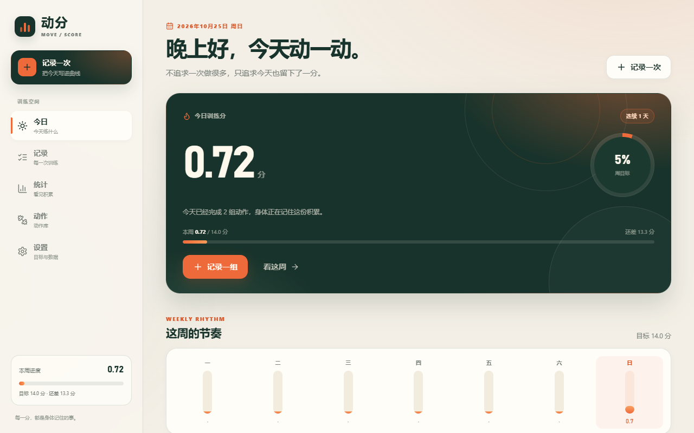
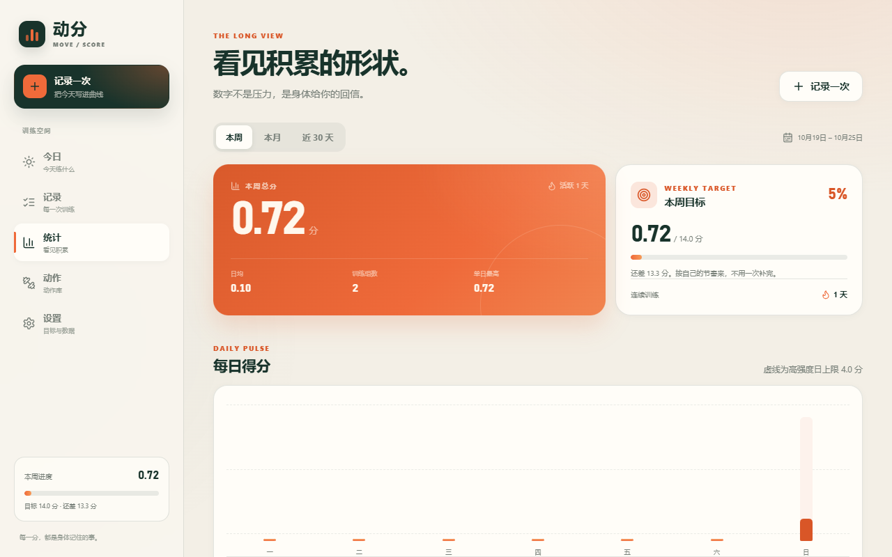
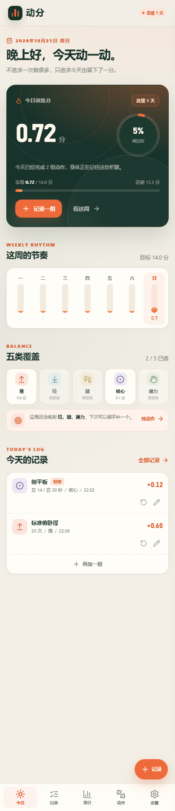

# 动分 · MOVE / SCORE

一个手机优先、可离线安装的自重训练计分 PWA。

不是训练计划打卡器，也不是社交健身 App。它只做一件事：把你今天实际完成的动作，折算成一个可累计、可回看的训练分。

## 在线使用

**https://wangyin06.github.io/dongfen/**

手机直接打开上面的 HTTPS 地址，按系统提示安装到主屏幕即可。


## 安卓安装包

如果不想经过浏览器安装，可以直接下载 APK：

**[dongfen-v1.0.3.apk](https://github.com/wangyin06/dongfen/releases/download/v1.0.3/dongfen-v1.0.3.apk)**

- 大小 1,404,565 bytes（约 1.34 MiB），支持 Android 8.0+
- 离线 WebView 壳，内置全部前端资源，首次启动也不需要联网
- JSON/CSV 导出会打开系统保存位置；JSON 导入会打开系统文件选择器
- 导出取消/失败会反馈给页面，不会误报“已保存”
- 支持双指缩放，低视力用户可以放大操作
- 数据保存在 App 自己的 WebView 存储中，与网页版数据互相独立
- 卸载 App 会删除其中的本地数据
- 使用 debug 签名，适合个人侧载，不是应用商店版本
- SHA-256：`2f5956c672cd9421afd313642bfb29be60bf69f201069bd7d3a7f4a341fd3d43`

安装时如果系统提示“未知应用”，需要在文件管理器/浏览器设置里允许“安装未知应用”。



## 为什么是「分」

传统打卡容易变成「今天练没练」的二元判断，但训练量、动作难度和完成质量其实一直在变化。动分用统一公式把这些差异折成分数：

```text
得分 =（实际次数或秒数 ÷ 基础单位）× 单位得分 × 质量系数
```

- 次数动作：基础单位 10 次
- 时间动作：基础单位 30 秒
- 左右侧动作：先分别计算左右，再相加
- 质量系数：标准 1.0 / 轻微变形 0.8 / 明显变形 0.5

旧版的一条循环（10 个跪姿俯卧撑 + 10 个坐姿屈膝 + 10 个标准深蹲 + 10 个靠墙天使 + 10 次提踵 + 左右手各 10 次握力器）约等于 **1.00 分**。

默认周目标 13 分，高强度日上限 4 分，轻松日上限 2 分，都可以在设置里调整。每周统计会同时检查推、拉、腿、核心、握力五类是否都有覆盖。

## 功能

- **今日**：今日总分、周目标进度、连续天数、7 日节奏、五类覆盖、今日记录
- **记录**：按日期分组、搜索、类别筛选、编辑、删除、再记一次
- **统计**：本周 / 本月 / 近 30 天，总分、日均、组数、单日最高、每日柱状图、类别分布、动作排行
- **动作库**：72 个内置动作，按模式与进退阶分组，支持搜索、类别/难度筛选；可添加自定义动作
- **快速记录**：两步完成，支持次数/秒数、左右侧分别记录、同步两侧、计时器、质量系数、备注、实时得分预览
- **设置**：周目标、日上限、周起始日、默认质量；JSON 完整备份、CSV 导出、JSON 合并/覆盖导入；清空数据
- **PWA**：manifest、service worker、离线缓存、主屏幕安装图标
- **本地优先**：没有账号、没有云端、没有追踪；数据只存在当前浏览器的 IndexedDB
- **输入保护**：关闭未保存的记录会确认；未来日期、非法次数/秒数会被拦截；计时器按真实时间计算，切后台不会少计
- **导出反馈**：JSON/CSV 会等待浏览器或 Android 系统确认保存结果；取消或失败不会误报成功，也不会擅自保存未确认的设置
- **无障碍与触控**：弹层焦点圈定/关闭恢复、筛选状态可读、图表可聚焦读屏、移动端操作按钮 44×44、正文与按钮达到 WCAG AA 对比度
- **稳定性**：备份读取使用单只读事务；版本号由 `package.json` 单一来源注入网页和 APK；18 个 Vitest 单元测试覆盖计分、日期、校验与备份

## 开发

要求：Node.js 20+、pnpm 11+。

```bash
pnpm install
pnpm dev        # http://127.0.0.1:5173
pnpm check      # TypeScript 类型检查
pnpm test       # Vitest 单元测试（18 个）
pnpm build      # 生产构建，输出 dist/
pnpm preview    # 预览生产构建
```

技术栈：React 19、TypeScript、Vite 7、`vite-plugin-pwa`、`idb`、`lucide-react`。样式为手写 CSS，不依赖 Tailwind 或外部字体 CDN，保证离线可用。

CI：`.github/workflows/web.yml` 在每次 push 执行 `pnpm check`、`pnpm test`、`pnpm build`；`.github/workflows/android.yml` 构建并上传 debug APK。

### 构建 APK

APK 是原生 Android WebView 壳，离线加载 `android/app/src/main/assets/www` 内的前端构建产物。构建由 `.github/workflows/android.yml` 完成：

1. `BUILD_TARGET=android` 构建相对路径、无 Service Worker 的 WebView 资源
2. 复制到 Android assets
3. Gradle `assembleDebug` 生成 `app-debug.apk`
4. 上传到 GitHub Actions artifact

本地构建需要 JDK 17、Android SDK 35、Gradle 8.9；直接使用 GitHub Actions 的 `Build Android APK` workflow 更省事。

## 数据与备份

数据库名：`dongfen-db`（IndexedDB）。

- **导出 JSON**：保留全部记录、设置和自定义动作，适合迁移或长期备份
- **导出 CSV**：适合用 Excel 查看；带 UTF-8 BOM，中文不会乱码
- **导入 JSON**：
  - 合并：保留现有数据，同 ID 记录由备份覆盖
  - 覆盖：先清空当前数据，再导入备份
- 清理浏览器站点数据会删除本地记录，建议定期导出 JSON

## 项目结构

```text
src/
  components/       # AppShell、LogSheet、RecordRow、Toast、通用 UI
  data/             # 72 个内置动作与分类元数据
  hooks/            # PWA 安装提示
  lib/              # 日期、计分、IndexedDB、备份校验
  pages/            # 今日、记录、统计、动作库、设置
  state/            # AppContext，统一数据读写
  App.tsx           # hash 路由与页面组合
  main.tsx          # React 入口
  styles.css        # 完整视觉系统与响应式布局
scripts/
  generate_icons.py # PWA 图标生成脚本
public/
  icons/            # 192/512/maskable 图标
  favicon.svg
  favicon.ico
  apple-touch-icon.png
docs/
  screenshots/      # 验收截图
```

动作分值和进退阶集中在 `src/data/exercises.ts`，可以按自己的训练水平调整。自定义动作会在运行时合并进动作库。

## 部署与安装

当前部署在 GitHub Pages，地址：**https://wangyin06.github.io/dongfen/**。

这是一个子路径部署，构建时需要指定 `PAGES_BASE`：

```powershell
$env:PAGES_BASE = '/dongfen/'
pnpm build
```

然后把 `dist/` 的内容发布到 `gh-pages` 分支（保留 `.nojekyll`）。如果部署到根路径（例如自有域名或 Cloudflare Pages），去掉 `PAGES_BASE` 重新执行 `pnpm build` 即可。

安装步骤：

- **Android / Chrome / Edge**：打开上面的 HTTPS 地址，浏览器菜单选择「安装应用」或「添加到主屏幕」
- **iPhone / Safari**：打开地址，点分享按钮 → 「添加到主屏幕」
- 首次打开需要联网；加载完成后，页面、动作库和已加载资源会被 service worker 缓存，之后可以离线记录

PWA 的 service worker 需要安全上下文：`localhost` 或 HTTPS。用手机通过局域网 IP 的普通 HTTP 访问时，页面能打开，但不能安装/离线缓存。数据仍然只保存在本机。

## 截图

| 今日（桌面） | 统计（桌面） |
| --- | --- |
|  |  |

| 今日（390px 手机） |
| --- |
|  |

## 验收记录

- `pnpm check`：TypeScript 无错误
- `pnpm test`：4 个测试文件、18 个用例全部通过
- `pnpm build`：Pages 构建成功，PWA service worker 预缓存 11 个资源（460.67 KiB）
- 桌面 1280px：今日、记录、统计、动作库、设置五页及记录/编辑/删除/导出流程已走通
- 手机 390px / 360px：今日、统计、记录、动作库无横向溢出；记录操作按钮 44×44；自定义动作入口可见
- 移动图表：柱体可聚焦并显示分数，读屏标签包含日期与分值
- 弹层：打开时背景 `inert`、关闭后焦点恢复；未保存记录关闭会确认
- 导出：取消/失败不会提示成功；JSON 导出不会保存未确认的目标设置
- 离线：关闭 preview 服务器后重新打开页面，应用仍可从 service worker 正常加载
- GitHub Pages 线上验收：页面、manifest、图标、JS/CSS 均为 200；service worker 作用域 `/dongfen/`；断网刷新后应用仍正常显示
- APK v1.0.3：GitHub Actions 构建成功，包内 JS 已注入 `1.0.3`，CSS 含最终弹层层级修复；Release 下载文件大小与 SHA-256 与构建产物一致
- 验收测试产生的记录和自定义动作已清空，默认周目标恢复为 13 分

## 版本

v1.0.3 · 本地优先 · 无账号 · 无云端
